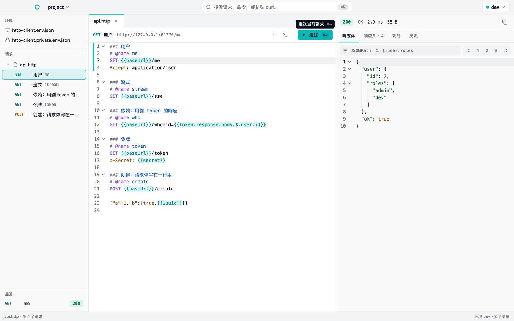
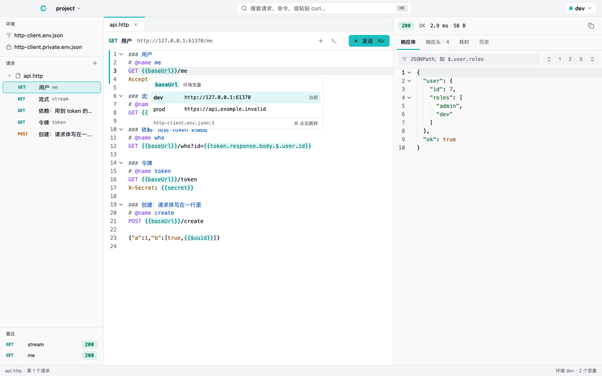
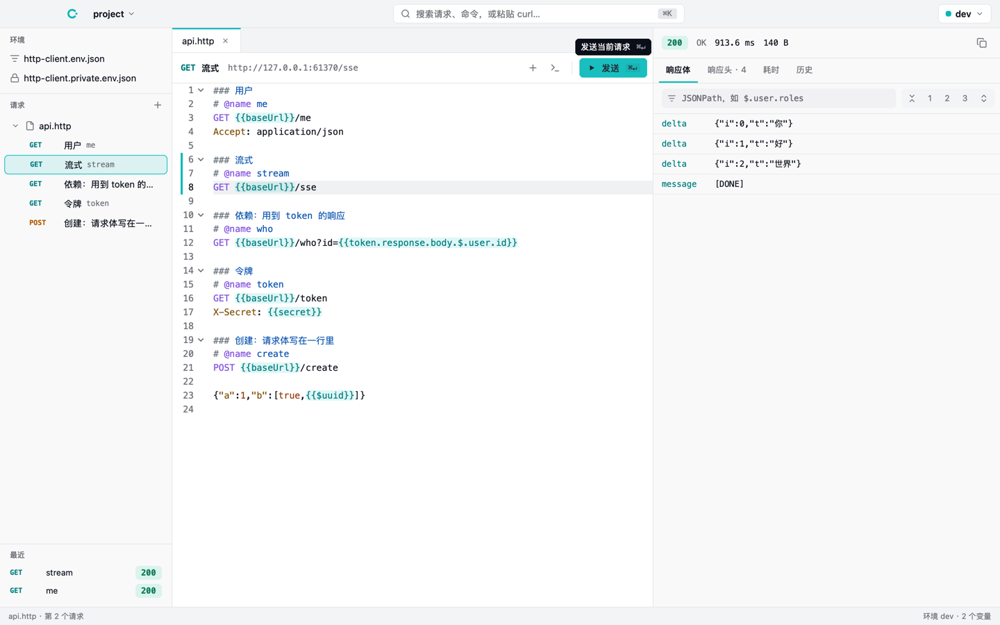
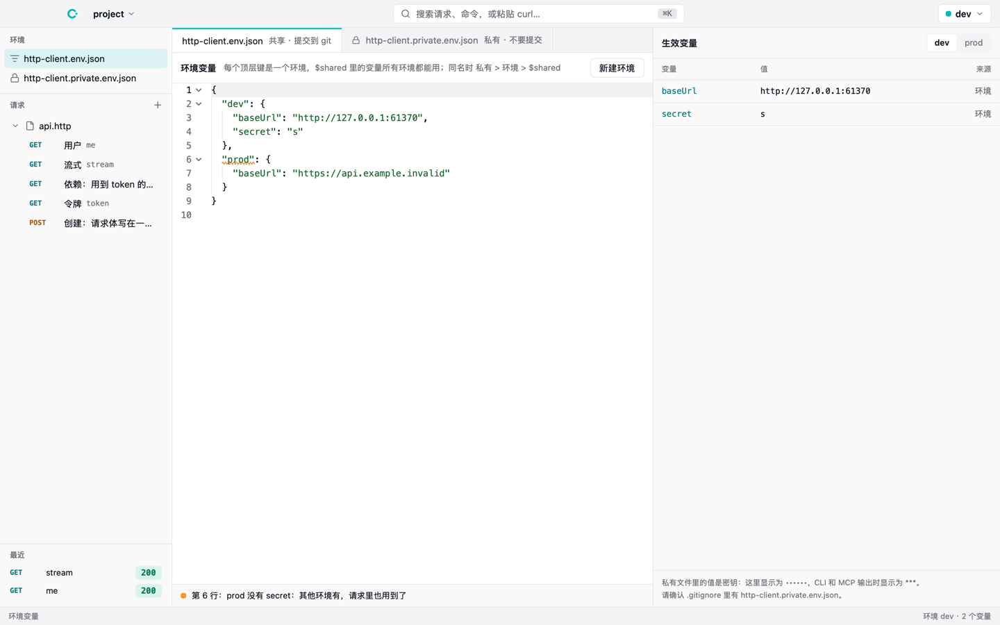
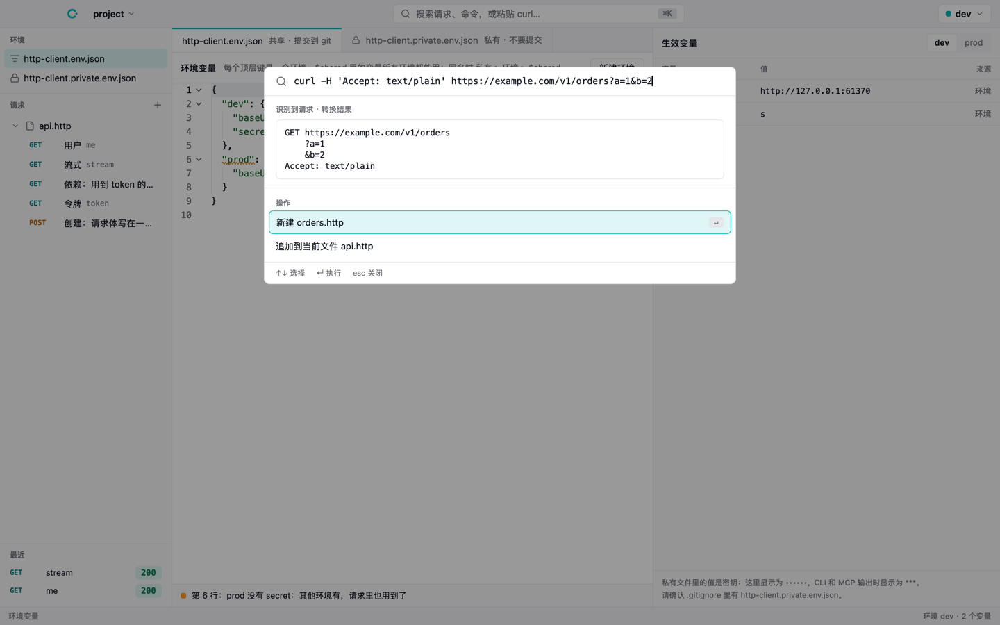
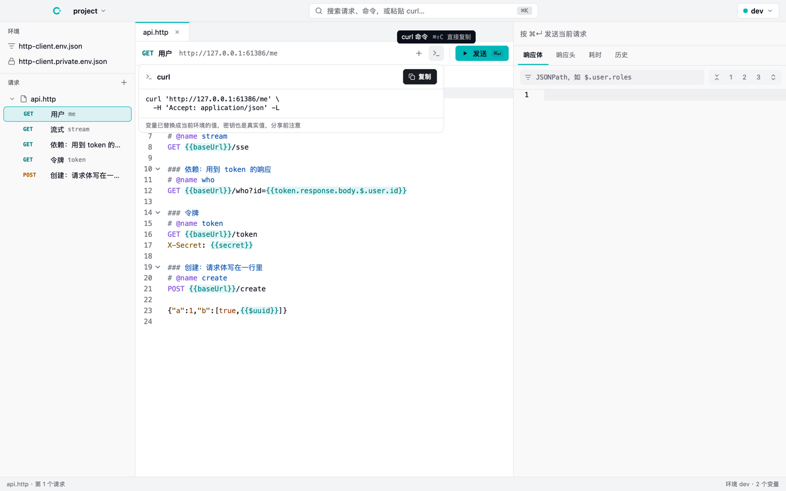

# callme

**A simple, fast, AI-friendly API client.** Requests live in plain-text `.http` files that the desktop app, the
command line and AI agents (through MCP) all run the same way.

[简体中文](README.zh-CN.md)



## Why

Postman grew into a platform. callme keeps the part you use every day and makes it work for AI agents too:

- **Files are the data.** A request is a few lines of text in a `.http` file: commit it next to your code, diff it,
  review it. No accounts, no cloud sync, no import/export. The format is the one the JetBrains HTTP Client and VS Code
  REST Client read.
- **Built for AI agents.** An agent edits `.http` files with its own tools and runs them with `callme run` or the MCP
  server, getting structured JSON back. Secrets are masked in everything callme prints.
- **Fast and native.** The desktop app draws native views with [nsh](https://github.com/longbridge/nsh); requests go
  out through libcurl, with the time of each phase (DNS, connect, TLS, first byte, download).

## The file format

```http
### Sign in
# @name login
POST {{baseUrl}}/auth/login
Content-Type: application/json

{"user": "{{user}}", "password": "{{password}}"}

### The signed-in user
# @name me
GET {{baseUrl}}/me
Authorization: Bearer {{login.response.body.$.token}}
```

- `###` separates requests; the text after it is the request's title, any text you like.
- `# @name` names a request, for references and for `file#name` on the command line.
- `{{baseUrl}}` comes from the environment: `http-client.env.json` (committed) and `http-client.private.env.json`
  (secrets, ignored), one top-level key per environment and `$shared` for all of them. A private value wins over the
  environment's, which wins over `$shared`.
- `{{login.response.body.$.token}}` takes a value from `login`'s newest response (JSONPath);
  `{{login.response.headers.Location}}` a header.
- `{{$uuid}}`, `{{$timestamp}}`, `{{$isoTimestamp}}`, `{{$randomInt}}` are dynamic values.
- Directives: `# @no-redirect`, `# @no-cookie-jar`, `# @timeout 5`, `# @insecure`.

The whole reference: `callme help format`.

## Command line

```sh
callme ls                                  # every request in the project
callme run posts/posts.http#get -e dev     # run one: readable in a terminal, JSON when piped
callme history posts/posts.http#get        # its latest responses
callme env                                 # environments and variables, secrets masked
pbpaste | callme import -o api.http        # a curl command or DevTools "Copy as fetch" to .http
callme open .                              # open this folder in the desktop app
callme mcp                                 # the MCP server, over stdio
```

Exit codes: `0` a response arrived (4xx and 5xx too, unless `--fail`), `1` the request could not be made, `2` the
input is wrong. Server-sent events print as they arrive.

### With Claude Code and other agents

```sh
claude mcp add callme -- callme mcp
```

The MCP server offers `list_requests`, `run_request`, `get_history` and `list_envs`. It writes no files: agents edit
`.http` files with their own tools, and the app reloads them as they change.

## Desktop app

| | |
|---|---|
|  |  |
|  |  |

- **Editor**: highlighting, completion of headers, variables and request names, hover cards with a variable's value in
  each environment, diagnostics (undefined variables, unknown requests, bad JSON), ⌘-click to go to a definition,
  folding by request.
- **Response**: JSON folded by its structure, JSONPath filter, server-sent events as they arrive, headers, the time of
  each phase, history.
- **⌘K palette**: requests and commands; paste a curl command and it becomes a request, its base URL and secrets
  replaced by the variables that hold them.
- **Shortcuts**: ⌘↵ send, ⌘N new request, ⌘⇧F format the JSON body, ⌘/ comment out a line, ⌘⇧C copy as curl,
  ⌘O open a folder.
- Files save as you type and reload when something else (an agent) changes them.



## Built with nsh

The desktop app is built on [nsh (Native Shell)](https://github.com/longbridge/nsh), Longbridge's native UI
framework: a Rust core that renders with each platform's own views (AppKit on macOS, Win32 on Windows, GTK 4 on
Linux), with screens written in TSX and Rust components alongside. callme uses it for:

- **The app itself**: a TSX app with a Rust crate of its own (`app/`), which exposes callme-core to TSX as a native
  module, so the app, the CLI and MCP share one implementation.
- **The editor**: nsh's `Editor` (highlighting, completion, hovers, go to definition, diagnostics, folding), with a
  `.http` highlighter written in Rust on callme-core's tokens, and the response's JSON shown and folded in a read-only
  one.
- **The rest of the UI**: native windows, the title bar and menus (`nsh/desktop`), overlays and tooltips, Tailwind
  classes over a theme from the Longbridge design tokens (`app/theme.json`), and light and dark appearances.
- **Tests and packaging**: `nsh test` runs the app's tests headless or in real windows (with screenshots), and
  `nsh package` builds `callme.app`.

The core and the CLI do not depend on nsh.

## Build from source

You need Rust (stable). The desktop app also needs nsh built from source, since the editor it uses is not in a
release yet:

```sh
curl -fsSL https://nsh.dev/install.sh | sh -s -- --source

cargo install --path crates/cli            # the callme command
cargo test --workspace                     # the core and the command line
scripts/test-app.sh                        # the desktop app's tests, headless
cd app && nsh run --target macos           # run the app (CALLME_PROJECT=<dir> picks the project)
cd app && nsh package --target macos       # build callme.app
```

Try it on the demo project: `callme open examples/demo`.

The layout: `crates/core` parses, resolves and runs requests (everything the app, the CLI and MCP share),
`crates/cli` is the `callme` command and the MCP server, `app/` is the desktop app (TSX on a Rust crate). The design:
[docs/superpowers/specs/2026-11-04-callme-design.md](docs/superpowers/specs/2026-11-04-callme-design.md) (Chinese).

## License

[Apache-2.0](LICENSE)
