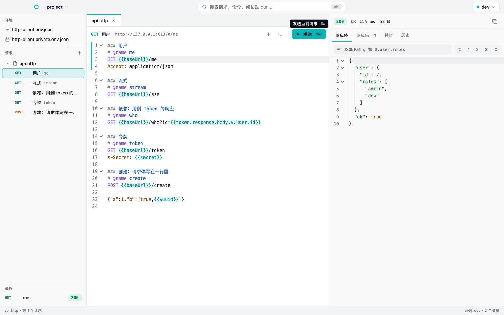

# callme

[English](README.md)



简洁、AI 友好的 API 调试工具。请求写在纯文本的 `.http` 文件里，在桌面 app、命令行和 MCP 里都能运行，三者结果一致。

- **文件就是数据**：请求是 `.http` 文本，可以进 git、可以 diff，没有数据库，也不用导入导出；格式兼容 JetBrains HTTP Client 和 VS Code REST Client。
- **AI 友好**：AI 直接读写 `.http` 文件，用 `callme run` 或 MCP 发请求、读响应；密钥在输出里一律打码。
- **快**：桌面版用 [nsh](https://github.com/longbridge/nsh) 原生渲染，请求由 libcurl 发出，能看到 DNS、连接、TLS、首字节、下载各阶段的耗时。

## 文件格式

```http
### 登录
# @name login
POST {{baseUrl}}/auth/login
Content-Type: application/json

{"user": "{{user}}", "password": "{{password}}"}

### 获取当前用户
# @name me
GET {{baseUrl}}/me
Authorization: Bearer {{login.response.body.$.token}}
```

- 变量写在项目根目录的 `http-client.env.json`（提交）和 `http-client.private.env.json`（密钥，不提交）里，每个顶层键是一个环境，`$shared` 对所有环境生效。
- `{{login.response.body.$.token}}` 取 login 最近一次响应里的值（JSONPath）。
- 指令：`# @name`、`# @no-redirect`、`# @no-cookie-jar`、`# @timeout 5`、`# @insecure`。

完整说明：`callme help format`。

## 命令行

```sh
callme ls                                  # 列出项目里所有请求
callme run posts/posts.http#get -e dev     # 执行；在终端里给人看，被程序调用时输出 JSON
callme history posts/posts.http#get        # 最近几次的响应
callme env                                 # 环境和变量（密钥打码）
pbpaste | callme import -o api.http        # 把 curl 或 DevTools 的 fetch 转成 .http
callme open .                              # 在桌面版里打开当前目录
callme mcp                                 # MCP server（stdio）
```

退出码：`0` 拿到了响应（包括 4xx、5xx，加 `--fail` 时除外），`1` 请求没能发出去，`2` 输入有误。

### 接入 Claude Code

```sh
claude mcp add callme -- callme mcp
```

MCP 提供 `list_requests`、`run_request`、`get_history`、`list_envs` 四个工具；AI 用自己的工具改 `.http` 文件。

## 桌面版

- 三栏：请求树、`.http` 编辑器（高亮、补全、悬停显示变量值、诊断、⌘ 点击跳转）、响应（按结构折叠、JSONPath 过滤、SSE 实时显示、耗时、历史）。
- `⌘K` 命令面板：搜索请求和命令，粘贴 curl 自动转换，并把能对上的值换成变量。
- `⌘↵` 发送（命令面板里：发送选中的请求），`⌘.` 停止，`⌘N` 新建请求，`⌘⇧F` 格式化 JSON 请求体，`⌘/` 注释一行，`⌘O` 打开文件夹。
- 文件自动保存；被外部（比如 AI）修改时自动重新加载。

## 基于 nsh 构建

桌面版基于 [nsh（Native Shell）](https://github.com/longbridge/nsh)，Longbridge 自研的原生 UI 框架：Rust 内核，用各平台自己的原生控件渲染（macOS 的 AppKit、Windows 的 Win32、Linux 的 GTK 4），界面用 TSX 写，也可以搭配 Rust 组件。callme 用到了它的这些部分：

- **app 本身**：一个带 Rust crate 的 TSX 应用（`app/`），Rust crate 把 callme-core 作为原生模块提供给 TSX，所以桌面版、命令行和 MCP 共用同一套实现。
- **编辑器**：nsh 的 `Editor`（高亮、补全、悬停、跳转到定义、诊断、折叠）；`.http` 的高亮器是用 Rust 写的，基于 callme-core 的分词；响应体的 JSON 用只读的 `Editor` 显示和折叠。
- **其余界面**：原生窗口、标题栏和菜单（`nsh/desktop`）、浮层和提示、Tailwind 类名，主题取自 Longbridge 设计系统的色值（`app/theme.json`），支持浅色和深色。
- **测试和打包**：`nsh test` 可以无界面运行，也可以在真实窗口里运行并截图；`nsh package` 打包出 `callme.app`。

core 和命令行不依赖 nsh。

## 开发

需要 Rust（stable）和从源码安装的 nsh（桌面版用到的编辑器还没有发布到 crates.io）：

```sh
curl -fsSL https://nsh.dev/install.sh | sh -s -- --source

cargo test --workspace                     # core 和命令行
cargo install --path crates/cli            # 安装 callme 命令
scripts/test-app.sh                        # 桌面版的无界面测试
cd app && nsh run --target macos           # 运行桌面版（CALLME_PROJECT=目录 指定项目）
cd app && nsh package --target macos       # 打包成 .app
```

示例项目在 `examples/demo`：`callme open examples/demo`。

设计文档：`docs/superpowers/specs/2026-11-04-callme-design.md`。
